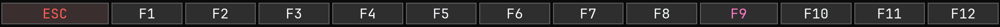
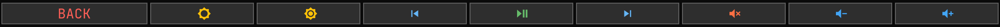

# Omarchy custom Touch Bar overlay

This directory contains a GPL-2.0 layout overlay for the programmable T1
Touch Bar userspace stack in
[`xeeban/macbook-t1-linux`](https://github.com/xeeban/macbook-t1-linux).

It does not contain Apple firmware or machine-personalized data. The build
script fetches the pinned public source, applies the small userspace patch in
`patches/`, overlays `dfr-layout.h`, compiles the three daemons, and renders
offline previews. Building does not switch the T1
to USB configuration 2, unload a driver, install a service, or reboot.

Internal layout names are retained for compatibility with upstream `dfr-fnd`:

| Gesture | Internal name | Visible row |
|---|---|---|
| default | `media` | Esc, workspaces 1-10, GPT menu, media menu, Omarchy |
| Fn | `fn` | Esc and F1-F12 |
| Ctrl+Fn | `ctrl` | status and system actions |
| MEDIA button | `alt` | Back, brightness, playback and volume |
| GPT button | `meta` | Back, ChatGPT, voice and productivity actions |

Workspace and Omarchy buttons launch scoped commands as the logged-in desktop
user. GPT and MEDIA are internal layer actions: they repaint the bar without
launching anything until a button inside the selected menu is tapped.

The patch also filters the T1 keyboard's short false Fn-release pulses. Fn
switches to F1-F12 immediately, while returning home requires a 600 ms quiet
release. This prevents repeated display redraws and `appletbdrm` timeouts.

## Build and preview safely

```bash
./scripts/build-custom-bar.sh
```

Artifacts and previews are written below ignored `.t1-work/custom-bar`; they
are not installed. Live activation remains an explicit, separately guarded
step because display mode replaces the currently working firmware strip.

After reviewing the build and rollback, a session-only test can be started:

```bash
sudo ./scripts/live-custom-bar.sh start
```

It uses only `/run`, does not configure boot persistence, and automatically
restores the firmware bar if a validation gate fails. Return manually with:

```bash
sudo ./scripts/live-custom-bar.sh stop
```

## Previews

Home row:


Function row:



AI/productivity row:


Media row:



## Licensing and provenance

`dfr-layout.h` is derived from the GPL-2.0 upstream layout at commit
`982d97a61a0c834d03e7cf7af5203b11ad7bae44`. It retains the GPL-2.0 SPDX
identifier. The rest of this repository remains under the licenses described
in the root README.
