# Omarchy custom Touch Bar overlay

This directory contains a GPL-2.0 layout overlay for the programmable T1
Touch Bar userspace stack in
[`xeeban/macbook-t1-linux`](https://github.com/xeeban/macbook-t1-linux).

It does not contain Apple firmware or machine-personalized data. The build
script fetches the pinned public source, applies the small userspace patch in
`patches/`, overlays `dfr-layout.h`, compiles the four daemons, and renders
offline previews. Building does not switch the T1
to USB configuration 2, unload a driver, install a service, or reboot.

## Prism Deck

The bar is an Omarchy-native, focus-aware control surface. A small local daemon
listens to Hyprland's active-window socket and selects a reviewed layout for the
focused application. It reads only the app class and window-title metadata in
memory; it never captures page or document bodies, sends window data off the
machine, logs titles, or turns titles into commands.

| Focused app family | Automatic deck | Primary controls |
|---|---|---|
| ChatGPT / Codex desktop app | `meta` | New, command search, files, panels, terminal, review, web, voice and dictation |
| Chromium / Firefox / Brave / Zen | `browser` | Back, forward, reload, URL, tab navigation, new/close tab, find and media |
| Foot / Omarchy TUIs / other terminals | `terminal` | Copy, paste, interrupt, clear, page scrollback, history, new terminal and tmux |
| VS Code / Cursor | `code` | Save, undo/redo, find/replace, command palette, terminal, format and run |
| Omarchy Editor launch (Neovim) / Neovide | `nvim` | LazyVim files, grep, tree, Git, save, format, diagnostics, terminal, new file and buffers |
| Nautilus / Thunar / Nemo / Dolphin | `files` | Back, forward, up, home, path, search, new folder, rename, hidden files, copy/paste |
| BlueBubbles / Discord / Slack / Signal / Teams | `comms` | New, search, edit actions, dictation, emoji, capture and AI |
| Obsidian / writing apps | `document` | Save, undo/redo, find, formatting, zoom, print and fullscreen |
| Evince / Okular / Papers | `reader` | Page navigation, first/last page, find, zoom, print and fullscreen |
| mpv / VLC / Spotify / YouTube | `music` | Playback, mute, volume, brightness and dictation |
| Everything else | `universal` | Edit, save, find, fullscreen, capture, dictation, AI, media and Omarchy |

Every automatic deck keeps `ESC` at the far left, a one-tap Home button, an
app-family identity pill, and a route to Media. The Home button opens the
workspace deck and leaves it in place until focus changes again. Specific web
apps are classified before the generic browser, so a Discord or YouTube window
gets communications or media controls rather than ordinary tab controls.

The renderer, kernel driver and touch mapper share a fail-closed layout
transaction fence. The driver's read-only sequence advances only after a full
framebuffer bulk OUT, at least one device response and a bounded response-queue
drain. The renderer marks a frame pending before submission and atomically
publishes the corresponding layout number only after that transaction succeeds;
the touch mapper ignores new contacts while pending and adopts the publication
only after all fingers are lifted. This is USB transaction fencing, not panel
pixel readback, so it prevents unresolved frames from enabling a different hit
map without pretending that Linux can inspect the OLED's physical pixels.

The Tokyo Night Prism design uses rounded neutral pills, restrained theme
accents and a fine color rail instead of full-button rainbow fills. On the Home
deck, empty workspaces use muted numerals, occupied workspaces gain a cyan dot,
and the current workspace becomes a bright blue selected pill. The renderer
polls local Hyprland workspace state every 400 ms and redraws only when it
changes.

Workspace zones also accept a horizontal drag. A tap opens that workspace;
dragging a number onto a different number moves every non-pinned window from
the source workspace into the destination, then opens the destination. The
merge runs only after release over another numbered zone, so buttons outside
the workspace strip are never drag targets.

The pink microphone on Home—and `DICTATE` buttons outside the Codex row—directly
toggle Omarchy's Voxtype recorder. Tap once to start, dictate, and tap again to
stop, transcribe, and type into the focused field. In the Codex row, `VOICE` and
`DICTATE` intentionally invoke Codex's own voice/dictation shortcuts. This
avoids synthetic F9 timing; the Fn row still exposes an ordinary F9 key.

## Manual decks and gestures

The complete custom interface is source-controlled in `dfr-layout.h`; the
commands it may launch are allowlisted in `touchbar-action.sh`.

| Row | Button | Action |
|---|---|---|
| Home | `ESC` | Sends Escape |
| Home | `1`–`10` tap | Opens that Hyprland workspace |
| Home | `1`–`10` drag | Moves all non-pinned windows from the first workspace to the drop workspace and opens it |
| Home | highlighted number | Indicates that workspace currently contains at least one app window |
| Home | `GPT` | Opens the GPT/productivity row; its actions focus ChatGPT before sending their shortcut |
| Home | `MEDIA` | Opens brightness, playback, and volume controls |
| Home | `OM` | Opens the main Omarchy menu |
| Home | microphone | Starts or stops Omarchy/Voxtype dictation |
| Function | `ESC`, `F1`–`F12` | Sends the corresponding ordinary keyboard key |
| System | Home icon | Returns home |
| System | `KBD`, `WIFI`, `BT` | Opens the Omarchy hardware menu |
| System | `BAT` | Opens the Omarchy system menu |
| System | `CAPTURE` | Opens Omarchy capture tools |
| System | `LOCK` | Locks the computer |
| Media | Home icon | Returns home |
| Media | brightness icons | Changes display brightness |
| Media | previous/play/next | Controls media playback |
| Media | mute/volume icons | Controls audio volume |
| Codex | Home icon | Returns home |
| Codex | `NEW` | Starts a new chat (`Ctrl+N`) |
| Codex | `CMD`, `FILES`, `OPEN` | Opens the command menu, searches files, or opens a folder (`Ctrl+K`, `Ctrl+P`, `Ctrl+O`) |
| Codex | `SIDE`, `BOTTOM`, `TERM` | Toggles the sidebar, bottom panel, or terminal (`Ctrl+B`, `Ctrl+J`, Ctrl plus the grave/backtick key) |
| Codex | `REVIEW`, `WEB` | Toggles review or opens a browser tab (`Ctrl+Alt+B`, `Ctrl+T`) |
| Codex | `VOICE`, `DICTATE` | Starts Codex voice or prompt dictation (`Ctrl+Shift+V`, `Ctrl+Shift+D`) |

Those Codex defaults were checked against the installed Linux desktop package
`openai-codex-desktop 26.820.80927-1`; the Touch Bar helper always focuses the
exact Codex/ChatGPT window address before sending them. If a future desktop-app
release changes its defaults, this table and the helper should be updated
together.

Tap Fn to switch between the current app deck and the function row; tapping it
again returns to the exact deck that was visible before F1-F12. `Ctrl+Fn` opens
the system row. The Home, GPT/AI, MEDIA and identity pills change rows entirely
inside the Touch Bar; they do not launch desktop windows by themselves.

The patch also filters the T1 keyboard's false Fn up/down pulses. Tap Fn once
to show F1-F12 and tap it again to return to the previous deck. Legitimate taps
can be only 90 ms apart. The renderer settles changes for 35 ms, keeps only the
newest requested layout, and caps full-frame USB pushes at one every 120 ms. Rapid
taps therefore remain responsive without flooding `appletbdrm`. Native hotkey
buttons pulse their modifier chord exactly once on initial contact through the
same `uinput` keyboard, so holding CLOSE/NEW cannot key-repeat. Command buttons
remain a fixed allowlist and run as the desktop user.

Omarchy's Editor shortcut (`Super+Shift+N`, or `omarchy launch editor`) launches
Neovim with the distinct `org.omarchy.nvim` app identity used by the automatic
deck. Typing `nvim` inside an already-open generic terminal intentionally keeps
the terminal deck because that existing Wayland window cannot change identity.
Every LazyVim leader button sends Escape first, so it is safe to tap while
Neovim is in Insert, Replace or Visual mode.

The kernel half drains every queued T1 frame-completion/status packet after an
upload and exposes its successful-frame sequence to the renderer. Reading only
the first short packet eventually filled the bulk IN queue and made later bulk
OUT transfers time out with `-110`. The combined fix passed 12 alternating
layouts at 250 ms and a 20-toggle test at 50 ms with no errors.

## Build and preview safely

```bash
./scripts/build-custom-bar.sh
```

Artifacts and previews are written below ignored `.t1-work/custom-bar`; they
are not installed. Live activation remains an explicit, separately guarded
step because display mode replaces the currently working firmware strip.

After reviewing the build and rollback, a session-only test can be started:

```bash
sudo ./scripts/live-custom-bar.sh start
```

For a friend to reproduce the tested path, they need the exact supported T1
model, an already activated production iBridge (`05ac:8600`), Omarchy/Arch,
the required build packages installed by `scripts/setup-omarchy.sh`, and a
working `voxtype` installation if they want dictation. ChatGPT is optional;
its buttons simply cannot focus an app that is not installed. Start with the
root README's read-only `scripts/status.sh` check and follow the path matching
the reported USB state. Do not copy another Mac's personalized T1 files.

It uses only `/run`, does not configure boot persistence, and automatically
restores the firmware bar if a validation gate fails. Return manually with:

```bash
sudo ./scripts/live-custom-bar.sh stop
```

Once the live test is proven on a `MacBookPro13,2`, make it survive shutdowns
and reboots with:

```bash
sudo ./scripts/install-custom-bar-service.sh
```

This enables both boot persistence and a post-resume relight unit for lid-close
suspend and hibernation.

The persistent renderer uses a black-pixel OLED policy: after two minutes
without keyboard, Touch Bar, or app-context activity it submits one black frame
and stops indicator refreshes. The first touch only wakes the strip; it cannot
activate an invisible button. Normal keyboard or context activity wakes the
current layout immediately.

Rollback to Apple's firmware-rendered strip with:

```bash
sudo ./scripts/uninstall-custom-bar-service.sh
```

## Previews

Home row:


Function row:


AI/productivity row:


Browser row:

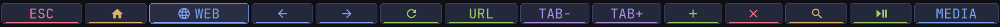

Terminal row:

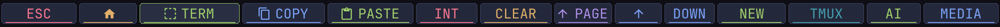

VS Code/Cursor row:

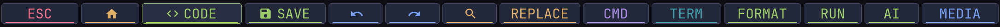

Omarchy Neovim/LazyVim row:

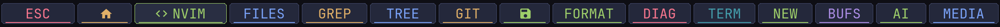

Files row:

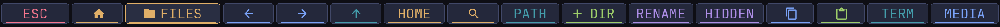

Communications row:

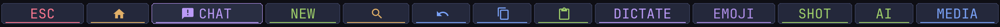

Writing/document row:

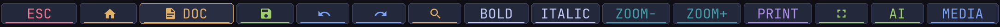

Universal fallback row:

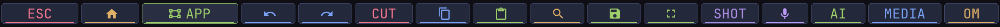

Document-reader row:

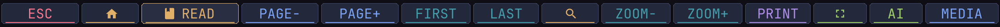

Music/video row:

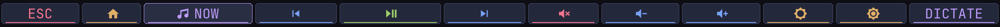

Media row:


System/status row:

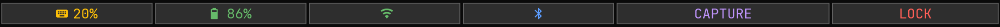

## Licensing and provenance

`dfr-layout.h` is derived from the GPL-2.0 upstream layout at commit
`982d97a61a0c834d03e7cf7af5203b11ad7bae44`. It retains the GPL-2.0 SPDX
identifier. The rest of this repository remains under the licenses described
in the root README.
